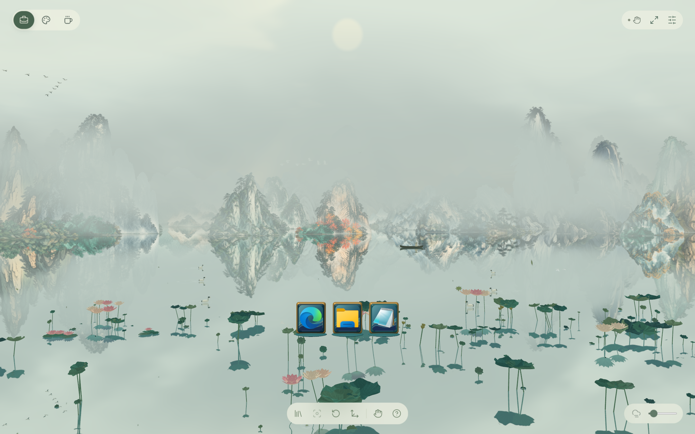
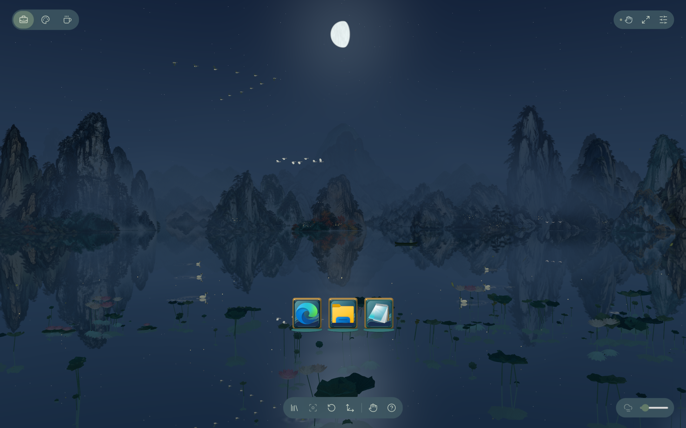
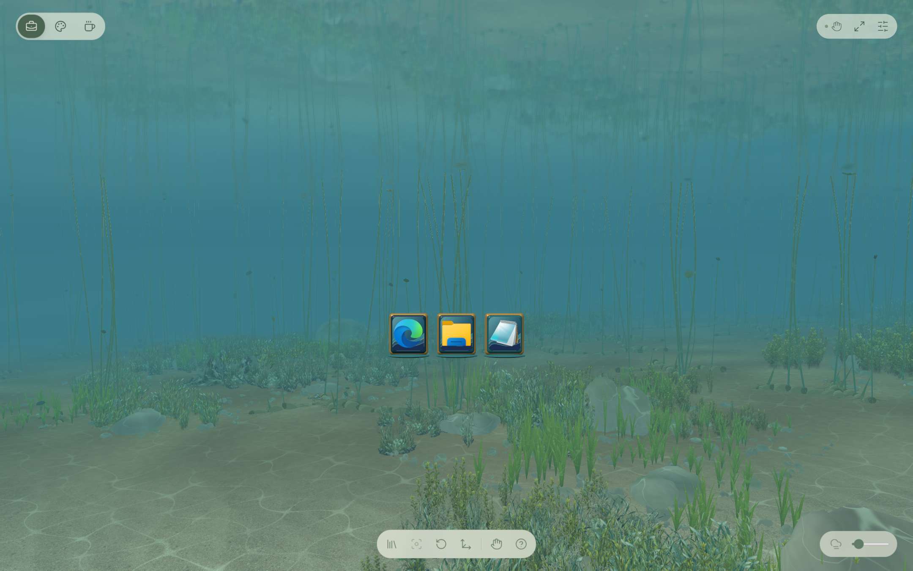

# 屿境 · AetherDesk

**把应用放进山水，把桌面变成可以游览的画卷。**

水墨山峦 · 烟水倒影 · 四时天候 · 湖底生灵 · 空间交互

Windows x64 · Three.js · WebView2 · .NET 8

[下载安装](https://github.com/Foursettingsun/AetherDesk/releases/tag/v0.9.20) · [画面展示](#画面展示) · [功能特色](#功能特色) · [安装与使用](#安装与使用)

屿境是一个以中国山水画为环境的 **Windows 三维交互桌面**。透明绘画素材在三维空间中层层展开，配合实时水面、流动山岚和昼夜光色，形成一幅可以环游、俯览与浅潜的山水画卷。

你可以把常用应用、快捷方式和文件夹放进不同的空间，在山水间整理和打开它们；也可以暂时停下操作，观看水鸟掠过、渔舟行进，以及云雾和日月缓慢变化。

当前版本：**0.9.20**。本仓库提供项目介绍、最新画面展示和成品安装包，**不包含项目源码**。

**[下载 Windows x64 Setup](https://github.com/Foursettingsun/AetherDesk/releases/download/v0.9.20/AetherDesk-0.9.20-Setup-x64.exe)** · [版本说明与校验文件](https://github.com/Foursettingsun/AetherDesk/releases/tag/v0.9.20)

## 画面展示

### 白昼 · 云雾、山水与荷塘

上方为白昼云雾天气的实景。远山、近岸与水面分层呈现，荷花、飞鸟和渔舟点缀其间；右键拖动可以继续环游。

光束以太阳中心为来源，穿过云隙和山体间隙照向湖面；金色集中在束状受光和对应水面光斑，普通雾保留原本的山岚底色。晴天不绘制云层，有云天气逐渐出现。

### 月夜 · 湖光与雁影

日月光景持续流转；可在设置中立即切换到晨曦、白昼、夕照或月夜，再从该状态继续变化。夜间还包含星光、流星、萤光与渔灯等场景细节。

### 浅潜 · 荷茎与湖底

向下移动视角可以进入水下，观察荷茎、水草、石群、气泡与游鱼。湖面与水下使用不同的光照和可见性处理，保留跨越水线时的过渡。

> 三张展示图片采集自 **0.9.19 实际运行程序**，分别展示白昼云雾、月夜和水下视角；0.9.20 的界面与光影细节已有更新。未使用概念图或生成图替代运行画面。采集说明见 [截图说明](docs/images/README.md)。

## 0.9.20 更新

- Dock 首项齿轮打开统一设置；天气、时令与时段旁显示当前状态，手动选择立即生效并继续自然变化。
- 晴天基础分配为 55%；白天时长在上一轮基础上延长 30%，夜间时长保持。
- 改善山体斜光投影、夕阳光束连续性、太阳渐变色及鱼体发光，补全一处主峰素材缺口。
- 收拢鱼群大小差距并缩小整体尺寸，水下自动续行更缓、更平滑。
- 优化分层抗锯齿、光雾、倒影、纹理调度及静态内容复用，Dock 保持高清；实际耗用以本机运行情况为准。
- 启动自动进入全屏，F11 可切回窗口；升级保留个人设置。

## 功能特色

| 内容 | 已有功能 |
| --- | --- |
| 水墨环景 | 分层山水、近岸亭阁、连续环游与有限高度的俯览。 |
| 水与山岚 | 动态微波、湖面倒影、触水涟漪、流动雾气与山隙光。 |
| 四时光景 | 晨昏与昼夜、季节色彩、晴雾雨雪及风力变化；支持手动选择。 |
| 湖面生态 | 荷塘、水鸟、雁阵、昼间渡舟与夜间渔船，动作带动水痕和波纹。 |
| 水下世界 | 草石与荷根、成群游鱼、局部气泡、焦散及夜间鱼光。 |
| 空间桌面 | 工作、创作、休憩三个空间；搜索、固定、拖动和打开真实应用、快捷方式或文件夹，每个空间最多 8 个入口。 |
| 输入方式 | 鼠标键盘可直接使用；可选 Leap Motion 手部追踪与液态双手表现。 |

应用会通过 Windows 在原生窗口中打开。目前没有把运行中的软件窗口实时贴进三维场景。

## 安装与使用

**[点击下载：AetherDesk-0.9.20-Setup-x64.exe](https://github.com/Foursettingsun/AetherDesk/releases/download/v0.9.20/AetherDesk-0.9.20-Setup-x64.exe)**

适用于 **Windows 10 / 11 x64**。联网 Setup 已包含完整场景资源。安装时检测 .NET 8 桌面运行库和 WebView2，已有且符合要求的组件会跳过，缺少时从微软下载。

下载后双击安装，选择安装目录，再通过桌面或开始菜单中的“屿境”启动。请下载 Release 中的 `.exe`；GitHub 的自动归档 ZIP 仅包含本仓库的介绍和图片。

安装版个人设置保存在当前用户的 `%LOCALAPPDATA%\AetherDesk\data`，升级保留个人设置。安装包已排除源码映射和调试符号。可通过 Release 中的 `SHA256SUMS.txt` 核对安装包。

普通使用不需要 Leap Motion。启用手势时，另需兼容的控制器和追踪运行时；设置中的“预览水质双手”可以单独观看外观效果。

| 操作 | 鼠标与键盘 |
| --- | --- |
| 环游场景 | 按住右键左右拖动，松开后缓慢续行。 |
| 俯览与浅潜 | 按住右键上下拖动。 |
| 调整远近 | 滚动鼠标滚轮。 |
| 打开入口 | 双击物体，或选中后按 Enter。 |
| 整理入口 | 按住左键稍作停留，再拖动。 |
| 停止巡游 | 按 Esc；也可在设置中选择视角归位。 |
| 环境设置 | 单击 Dock 第一项齿轮进入统一设置，调整画质、光景、天气、风力和山岚。 |

普通点击、滚轮和整理操作会暂时暂停巡游，结束约 5 秒后恢复；打开面板时保持暂停，关闭后重新计时。

## 技术实现

| 层级 | 实现 |
| --- | --- |
| Windows 宿主 | C# / .NET 8 / WinForms，负责窗口、应用启动、设置保存和设备连接。 |
| 嵌入式渲染容器 | Microsoft WebView2。 |
| 场景与特效 | Three.js 0.186.1、JavaScript 与 GLSL。 |
| 美术组织 | 透明二维山水素材在三维空间中分层布景，搭配三维生物、舟船和程序化水雾。 |
| 构建与安装 | esbuild 构建前端，NSIS 制作 Windows 安装包。 |

当前渲染继续使用 **Three.js**。

程序按实际可见内容绘制：完全潜入水下后减少岸上山体绘制，完全出水且反光遮挡湖底时减少不可见水下物体；夜间保留鱼光附近的水下内容。当前渔船采用三维模型，保留人物比例与划桨动作；小卵石使用带法线与高度信息的浮雕素材，大石头保留原模型。

近期还更新了高清居中 Dock、入水浮起、荷塘不同生长阶段、鱼群模型细节及近处更清晰平静的水面倒影。0.9.20 在上一轮本地版本基础上，将鱼群大小差距收拢 40%，再将整体平均尺寸缩小 20%；荷塘沿用此前增加约 15% 的出现频率。

项目仍在持续开发和视觉调整中，不同电脑的实际帧率以运行结果为准。
